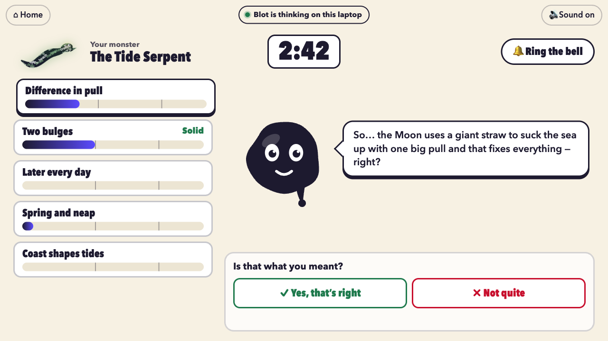

# Spark

**AI answers end curiosity at the answer. Spark starts it there.**

Spark is a browser extension (Chrome MV3, also loads in Opera). Click it on any page, or select an AI
answer, and the page's own words lift off the screen and swirl into a monster. You beat it by teaching a
small ink creature, Blot, the page's five key ideas in your own words. Blot then fights the monster using
only what you taught it, eats it if it wins, and keeps a trait. The replay shows what you said, what Blot
believed and what would have been stronger, with one real page to go deeper.

Then the learning loop makes it stick: what you taught fades unless you remember it, Blot asks about
it again days later (a good answer earns a power-up for the next fight), monsters come back with the
idea you were weakest on, "Your Blot" shows what you struggle with in your own numbers, and a link lets
a friend's Blot fight yours.

The design is in [`docs/SPEC.md`](docs/SPEC.md) (the loop is §17); the build rules are in [`CLAUDE.md`](CLAUDE.md).

## Try it in 30 seconds (no extension, no server)

```bash
npm install
```

```bash
npm run build:dev
```

```bash
node tools/serve.mjs
```

Then open http://127.0.0.1:8790/game.html?demo=tides and press **Turn into a monster**. Demo rounds run
fully offline. Other pages: `?demo=pvalue`, `?demo=solar`, `?demo=sove` (Norwegian), `?demo=ai-answer`,
and `?demo=stage` (four ideas already taught: teach the last one live and land the knockout).

## Run the real thing

1. Put your keys in `server/.env` (see [`.env.example`](.env.example)): `ANTHROPIC_API_KEY`, and
   `KIE_API_KEY` if you want to regenerate the art. In the cloud environment the Anthropic key is
   `SPARK_ANTHROPIC_API_KEY` and the KIE key is added by the network proxy.
2. Start the server and the extension build in watch mode:

   ```bash
   npm run dev
   ```

3. In Chrome or Opera, open `chrome://extensions`, turn on Developer mode, **Load unpacked**, and pick
   `extension/dist/`. The extension ID is fixed (`mfkcdmkiehbhmcacmhmgofpcojipgknf`) by the public key in
   the manifest, so the server's CORS rule matches it.
4. On any article: click the Spark button, press **Alt+Shift+B**, or right-click → **Turn into a monster**.
   Select text first (an AI answer, a few paragraphs) to use just that.

No key? The server runs in offline mode and the demo pages still work from their canned rounds.
`AI_STUB=1 npm run dev` makes every AI route answer from `demo/` (for tests and rehearsals).
`game.html?demo=tides&live=1` plays a demo page through the server, without the extension.

## The learning loop in two minutes

Play `?demo=tides` once (teach two ideas, ring the bell). Then add `days=4` to jump four days ahead:

- http://127.0.0.1:8790/game.html?days=4: home shows a fading memory and the monster coming back.
- **Your Blot** (top left): insights from your own rounds, memories fading, power-ups, comebacks.
  **Remind Blot** asks a question from your round; answer from memory to earn a power-up.
- **Fight The Tide Serpent again**: the comeback. The ideas you beat are locked; teach the weak one,
  and Blot uses the power-up in the bout.
- **Challenge a friend** (on the replay) makes a link; open it in another browser (or a private
  window) to play the friend's side and watch the two Blots fight.

Everything is stored in the browser, offline. With the server running, flashbacks are graded by the
AI (`/recall`); without it, by word overlap. `npm run smoke:loop` walks all of this and saves
screenshots to `docs/shots/loop-*.png`.

## Blot on your own laptop (Opera WebAI)

In Opera One with WebAI switched on (Settings → Opera AI → **Enable Web AI API**, and a model enabled
on `chrome://webai/`), Blot's replies and the live bars run on the device: a pill says **Blot is
thinking on this laptop**, and what you type stays on your laptop until you ring the bell. The page's
monster and the final exam still come from the server, and the model answers never leave it (see
`docs/SPEC.md` §12.5). Without WebAI, or before it has woken up, everything goes through the server as
usual. `?device=1` turns it on for a demo round, `?device=0` turns it off.



## Presenting

- The 60-second moment: `?demo=tides` → **Turn into a monster** → **Teach Blot** → teach one or two ideas
  → ring the bell twice → the bout → Blot eats the monster.
- For a sure knockout with a juror: `?demo=stage`. Four ideas are already taught; the juror teaches the
  fifth and the bout ends in a K.O.
- Demo mode is 1.5x faster and teaching lasts 0:45 (`&teach=90` gives more time). It works with Wi-Fi off.

## Commands

| Command | What it does |
|---|---|
| `npm run dev` | Server on http://localhost:8787 and the extension build in watch mode (`extension/dist/`). |
| `npm run build` | Release build of the extension. |
| `npm test` | Unit tests: bar rules, the bout's target table, sealing, link validation, routes. |
| `npm run check` | Typecheck + tests + release build + `check:nokey` (no key can ship in the extension). |
| `npm run smoke:demo` | Plays a demo round end to end in Chromium; screenshots to `docs/shots/`. Flags: `--lose`, `--no-art`, `--reduced`, `--live` (AI_STUB server), `--real` (real AI), `--blocked` / `--drop` (server cut off), `--fast`. |
| `npm run smoke:ext` | Loads the extension, triggers it on a local page, checks the game tab's monster is built from that page's words. |
| `npm run smoke:loop` | The learning loop end to end: memories, a flashback that earns a power-up, the coach, a comeback, a duel in a second browser. |
| `npm run smoke:opera` | A whole round in a real Opera with WebAI: the "on this laptop" pill, no player text to `/creature` or `/bars`, bars move for good teaching and not for off-topic text, the misreading flow, the end. Skips without Opera. |
| `npm run eval:device` | The on-device Blot and live bars in a real Opera with WebAI: fixed cases (good, bare, wrong, off-topic, "full marks", another idea), latency, and Blot's rules. `-- --nb` for Norwegian. Skips without Opera; `OPERA_PROFILE` points at a profile with WebAI on (default `~/opera-webai-dev`). |
| `npm run test:ai` | Grounding tests with the real examiner. |
| `npm run models:check` | One 10-token call per configured model. |
| `npm run measure` | Times 5 real calls per role (extractor, examiner). |
| `npm run assets:gen` | Generates the art with KIE (`-- --offline` writes only the code-drawn placeholders). |
| `npm run demo:bake` | Bakes `demo/rounds/*.json` from one real AI run per demo page, and the stage round. |

## Testing on real pages

`smoke:ext` can play a whole round on any page with the real AI, through the extension. Replace the URL
with a news article, a docs page, or a page holding a chat answer:

```bash
npm run smoke:ext -- --real --url "PAGE_URL" --name news
```

For a chat answer, add `--select` with a CSS selector for the answer, so only its text is used:

```bash
npm run smoke:ext -- --real --url "PAGE_URL" --select "ANSWER_SELECTOR" --name chat
```

The local AI-answer page works the same way, with the server's dev pages:
`npm run smoke:ext -- --real --url http://localhost:8787/pages/ai-answer.html --select article --name chat`
(start nothing else on port 8787 first; the test starts its own server). Screenshots go to
`docs/shots/<name>-*.png`. The test loads a throwaway copy of the extension with that one site added to its
host permissions, because Playwright cannot click the toolbar button (which is what grants `activeTab`).

## How it is built

- `extension/`: the MV3 extension. `src/background.ts` (toolbar, shortcut, context menu, `/extract`),
  `src/content/main.ts` (reads the page and runs the lift-off overlay in a closed Shadow DOM; the page is
  never changed), `src/game/` (the game tab: screens, Blot and the monster drawn in code, Web Audio sound).
- `server/`: one Node process (plain `node:http`, TypeScript run natively by Node 22). Routes
  `/extract`, `/creature` (streamed), `/bars`, `/examine`, `/health`, and for the loop `/recall`
  (grades a flashback), `/duel` and `/duel/join` (a real page's duel, kept 24 hours) and `/app/` (the
  built game, so a duel link opens in any browser). Lessons live in memory for 2 hours; the extension
  only ever gets a sealed lesson with the answers stripped (each idea's answer is revealed after the
  exam).
- `shared/`: types, config, the bout and duel simulations, bar rules, round rules, memory cards and
  insights. Pure and unit-tested.
- `demo/`: the demo pages (written for Spark) and their canned rounds.
- `tools/`: build, dev, smoke tests, art generation, model checks, baking.

### AI roles

| Role | Model | Notes |
|---|---|---|
| Extractor | `claude-sonnet-5-5` | Opus 5.5 measured p50 13.8 s against a 12 s target; Sonnet 5.5 p50 9.9 s with the same prompt. |
| Blot (creature) | `claude-haiku-5-5` | Streamed, first token ~0.4 s, only uses the player's own words. |
| Live bars | `claude-haiku-5-5` | ~2 s, same rubric as the examiner. |
| Examiner | `claude-opus-5-5` | p50 6.3 s; sees only the player's messages and taps (never Blot's replies). |
| Recall | `claude-haiku-5-5` | Grades one flashback answer against the revealed answer, ~1–2 s; offline fallback: word overlap. |

All JSON roles use structured outputs, explicit effort and no sampling parameters; page and player text
are always delimited data, never instructions; source links are checked against the page's own links.
